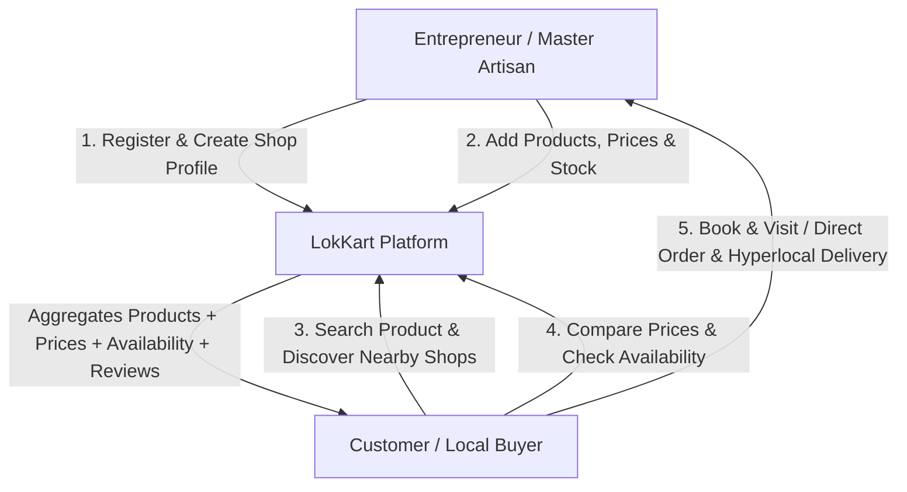

# 🛍️ LokKart (ODOP Direct) — The Digital Doorway to Your Local Market

> **LokKart** connects local artisans, entrepreneurs, and neighborhood shops directly with nearby customers and global craft enthusiasts.

**Live Platform**: 
**Local Development**: [http://localhost:3000](http://localhost:3000)

---

## 👥 Team Members
- **Prince Mayank Ranjan**
- **Bishwanath Kumar**
- **Ujawal Mishra**

---


## 🚨 Problem Statement

- **Small Artisans Lack Visibility**: Traditional craftsmen and small sellers lack digital reach and modern e-commerce tools.
- **Failed Local Product Discovery**: Fragmented physical markets make finding local, authentic products time-consuming.
- **Missing E-Commerce Infrastructure**: Small entrepreneurs struggle to set up online catalogs, stock updates, and digital payment gateways.
- **Overlooked Local & Cultural Identity**: Generic marketplaces fail to highlight **One District One Product (ODOP)** heritage, GI Tags, and regional craft stories.
- **Inefficient Short-Distance Delivery**: Lack of hyperlocal delivery options slows down neighborhood transactions.
- **Scaling Local Demand**: Artisans cannot reach wider regional or national buyers without complex supply chains.

> *"A great product can fail if nobody knows it exists."*

---

## 💡 The Solution — LokKart

LokKart is a **locality-first e-commerce and discovery platform** that acts as a digital bridge between local entrepreneurs and customers:

- **Instant Digital Infrastructure**: Allows business owners to launch a full digital store in minutes with product listings, real-time inventory, and price management.
- **Enhanced Product Visibility**: Enables buyers to discover products crafted right in their district or nearby regions.
- **Hyperlocal & Direct Buying**: Offers 3-hour hyperlocal delivery and direct self-pickup reservations.
- **Multilingual AI Assistants**: Integrated AI Voice & Chatbot powered by Google Gemini API so sellers can manage orders hands-free and customers can query products naturally.
- **Preserving Craft Identity**: Built-in verification for ODOP District codes, GI Tags, and Government Artisan Cards.

---

## ⭐ Why LokKart?

- 📍 **Find Nearby Products**: Search and discover authentic local products within a specified district or kilometer radius.
- 🏷️ **Compare Local Prices**: Direct-from-artisan pricing without middleman markups.
- ⚡ **Check Real-Time Availability**: Know if an item is in stock before traveling to the store.
- 🚀 **Simple & Fast**: Easy navigation designed for all generations of users.
- ❤️ **Support Local Economy**: Empowers local artisans, weavers, and small businesses to grow.

---

## 🔄 How LokKart Works / Workflow



---

## ✨ Key Features

### 🏪 For Entrepreneurs & Sellers
- **Easy Registration**: Quick merchant onboard process with phone OTP verification.
- **Digital Shop Profile**: Customize storefront banner, profile avatar, bio, and workshop gallery.
- **Product & Variant Showcase**: Add high-resolution images, descriptions, specs, color hex codes, and sizes.
- **Real-Time Inventory Management**: Instant stock updates, price changes, and discount percentage calculations.
- **AI Seller Assistant**: Voice and chat bot answering questions about daily sales, pending orders, returns, and earnings.
- **Order & Booking Management**: Track orders across fulfillment stages (Placed, Preparing, Ready for Pickup, Out for Delivery, Completed).
- **Verified Artisan Badges**: Display Government Artisan Card numbers, GSTIN, and Bank verification badges.

### 👥 For Customers & Buyers
- **Simple Access**: Instant customer login and profile management.
- **Local Product & District Search**: Filter products by category, district (e.g., Madhubani, Varanasi, Bhagalpur), price, and distance.
- **Real-Time Availability Check**: Verify stock status before visiting a local shop.
- **AI Voice Product Assistant**: Search products naturally using voice commands in multiple languages.
- **Direct WhatsApp & Phone Connect**: One-click direct communication with master artisans.
- **Transparent Price Comparison**: Compare authentic local craft prices effortlessly.
- **ODOP & GI Tag Certification Badges**: Buy certified regional specialties with full confidence.

---

## 📊 Market Analysis & Impact

```
┌─────────────────────────────────────────────────────────┐
│                     MARKET ANALYSIS                     │
├──────────────────────────┬──────────────────────────────┤
│ 01. DIGITAL SHIFT        │ Customers increasingly       │
│                          │ discover products online.    │
├──────────────────────────┼──────────────────────────────┤
│ 02. LOCAL GAP            │ Small shops lack digital     │
│                          │ product-level visibility.    │
├──────────────────────────┼──────────────────────────────┤
│ 03. CUSTOMER NEED        │ Know price & availability    │
│                          │ before visiting or ordering. │
├──────────────────────────┼──────────────────────────────┤
│ 04. OPPORTUNITY          │ A locality-first platform    │
│                          │ connecting both sides simply.│
└──────────────────────────┴──────────────────────────────┘
```

### 🌟 Key Innovations & Impact
1. **Local-First Product-Level Visibility**: Digitizes individual product listings rather than just store names.
2. **Compare Before You Visit**: Prevents wasted trips by providing upfront price and stock transparency.
3. **Know Before You Go**: Live stock status saves time and transport costs for local buyers.
4. **Empowering Local Businesses**: Brings traditional Indian markets into the modern digital economy.

---

## 🛠️ Technology Stack

- **Framework**: [Next.js 16](https://nextjs.org/) (App Router, Turbopack, React 19)
- **Styling**: Vanilla CSS & Tailwind CSS with custom brand design tokens (`docs/design-system.md`)
- **Database**: [MongoDB Atlas](https://www.mongodb.com/cloud/atlas) with Mongoose ODM
- **AI Engine**: Google Gemini API (Universal AI Voice Assistant & Seller Chatbot)
- **Payment Gateway**: [Razorpay](https://razorpay.com/) Integration
- **Icons**: [Lucide React](https://lucide.dev/)
- **State Management**: React Context API (`StoreContext`)

---

## 🚀 Getting Started & Local Setup

### Prerequisites
- **Node.js**: `v18.x` or higher
- **npm**: `v9.x` or higher
- **MongoDB**: Local MongoDB instance or MongoDB Atlas Connection String

### 1. Clone the Repository
```bash
git clone https://github.com/ayush/ODOP.git
cd ODOP-master
```

### 2. Install Dependencies
```bash
npm install
```

### 3. Environment Variables
Create a `.env` file in the root folder with the following keys:
```env
MONGODB_URI=your_mongodb_atlas_connection_string
GEMINI_API_KEY=your_google_gemini_api_key
RAZORPAY_KEY_ID=your_razorpay_key_id
RAZORPAY_KEY_SECRET=your_razorpay_key_secret
NEXT_PUBLIC_APP_URL=http://localhost:3000
```

### 4. Seed Database (Initial Sellers, Products & Orders)
Start the local development server:
```bash
npm run dev
```
Then visit `http://localhost:3000/api/seed` in your browser or run:
```bash
curl -X POST http://localhost:3000/api/seed
```
*This populates MongoDB with 6 master sellers, 17+ ODOP products with color/size variants, orders, and returns.*

### 5. Build for Production
```bash
npm run build
npm run start
```

---

## 🌐 Deployment
- **Production URL**: 

---

## 🤝 Acknowledgments & Team

Designed and developed with ❤️ for local Indian artisans and small business owners by:
- **Prince Mayank Ranjan**
- **Bishwanath Kumar**
- **Ujawal Mishra**
*Thank you for supporting LokKart and empowering local businesses!*
#
